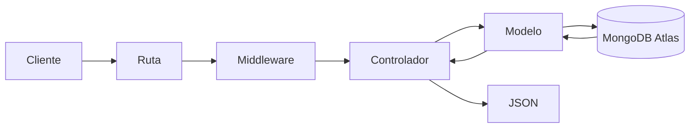

# API Nana Nocturna

Este es el backend de mi proyecto Nana Nocturna. Es una API REST creada con Node.js, Express y Mongoose. Permite consultar las piezas de la colección y, con una cuenta de administrador, crearlas, modificarlas o eliminarlas. Los datos se guardan en MongoDB Atlas.

- Repositorio: [nana-nocturna-api](https://github.com/nadiamoukrimg/nana-nocturna-api)
- API desplegada: [https://nana-nocturna-api.vercel.app](https://nana-nocturna-api.vercel.app)

## Tecnologías

- Node.js y Express
- MongoDB Atlas y Mongoose
- bcryptjs para comprobar contraseñas cifradas
- jsonwebtoken para crear y comprobar tokens
- Vercel para el despliegue

## Organización

```text
backend/
├── src/
│   ├── config/          # Conexión con MongoDB Atlas
│   ├── controllers/     # Lógica de piezas y autenticación
│   ├── middlewares/     # Autenticación, permisos y gestión de errores
│   ├── models/          # Esquemas Pieza y User
│   ├── routes/          # Rutas de la API
│   ├── utils/           # Funciones auxiliares
│   └── app.js           # Configuración de Express
├── tests/
│   ├── requests.http
│   └── API Nana Nocturna.postman_collection.json
├── .env.example
├── package.json
└── server.js
```

## Modelos

El modelo `Pieza` está conectado a la colección `piezas` de Atlas. Tiene campos como `nombre`, `descripcion`, `categoria`, `precio`, `estado`, `disponible`, `imagen`, `imagenesGaleria`, `materiales`, `medidas`, `coleccion`, `piezaUnica`, `personalizable`, `fechaCreacion` y `creadoPor`.

El modelo `User` utiliza la colección `usuarios`. Guarda `nombre`, `email`, `password`, `rol`, `activo` y `fechaRegistro`. Las contraseñas se guardan como hashes, no como texto normal. Los roles usados son `admin` y `cliente`.

## Rutas disponibles

| Método | Ruta | Acceso | Función |
|---|---|---|---|
| GET | `/api/products` | Público | Lista todas las piezas. |
| GET | `/api/products/:id` | Público | Devuelve una pieza por su ID. |
| POST | `/api/products` | Administrador | Crea una pieza. |
| PUT | `/api/products/:id` | Administrador | Actualiza una pieza. |
| DELETE | `/api/products/:id` | Administrador | Elimina una pieza. |
| POST | `/api/auth/login` | Público | Comprueba el email y la contraseña e inicia sesión. |

Para las operaciones de administrador se envía el token recibido al iniciar sesión mediante la cabecera `Authorization: Bearer <token>`. Una petición sin iniciar sesión responde con `401`; una cuenta que no es administradora recibe `403`.

Las respuestas de la API están en JSON. También hay middlewares para las rutas inexistentes y para gestionar errores.

## Instalación y ejecución local

Necesitas tener Node.js instalado. Desde una terminal, entra en la carpeta `backend` y ejecuta:

```powershell
npm.cmd install
Copy-Item .env.example .env
```

Completa las variables de `backend/.env` con los datos de tu entorno y arranca el servidor:

```powershell
npm.cmd run dev
```

La API local estará en `http://localhost:3000`.

## Variables de entorno

El archivo `.env.example` indica los nombres de las variables necesarias:

```env
MONGODB_URI=
PORT=3000
JWT_SECRET=
```

- `MONGODB_URI`: cadena privada de conexión de MongoDB Atlas. La base de datos utilizada es `nana_nocturna`.
- `PORT`: puerto local del servidor.
- `JWT_SECRET`: secreto que se usa para firmar los tokens de inicio de sesión.

No subas el archivo `.env` ni compartas sus valores. En Vercel, las variables se configuran en los ajustes del proyecto, no dentro del código.

## Pruebas

En `tests/requests.http` están las peticiones para probar la API con la extensión REST Client de Visual Studio Code. También se incluye una colección que se puede importar en Postman.

Las pruebas incluyen consultas, inicio de sesión y operaciones protegidas. Para probar PUT y DELETE, utiliza el ID de una pieza de prueba. DELETE elimina de Atlas la pieza indicada. Antes de subir los archivos a GitHub, deja marcadores en lugar de tokens reales y no incluyas contraseñas.

## Despliegue

La API está desplegada en Vercel. La variable `MONGODB_URI` y el secreto `JWT_SECRET` se configuran en las variables de entorno del proyecto de Vercel. La dirección base es:

```text
https://nana-nocturna-api.vercel.app
```

## Flujo de la API

